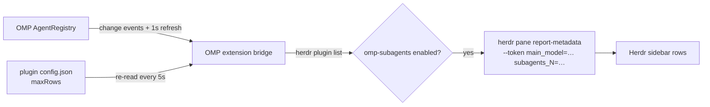

# herdr-omp-subagents

[](https://github.com/hanbong5938/herdr-omp-subagents/releases)


When several [OMP](https://github.com/can1357/oh-my-pi) panes are open in
[Herdr](https://herdr.dev), the agents sidebar can show the
current model of each pane's main agent without switching panes. This plugin
also shows the models of subagents while they are running. Even with no child
running, the main-model row is useful: it stays visible while the session is
attached, idle or busy, and follows `/model`. Child rows disappear when the
children finish. This is a current-model display, not a completion, progress,
or usage dashboard.

Observed in a Herdr 0.9.3 / OMP 18.9.1 terminal session (text excerpts, not
screenshots):

```text
○ onboarding-smoke
  probe · (gpt-6.1-sol)
```

While a sonic child was running, an additional row showed:

```text
  sonic:gpt-6.1-sol
```

## Quick start

> [!NOTE]
> Requires Herdr 0.8+ and OMP 18.1.20+ on macOS or Linux. Also observed on
> Herdr 0.9.3 with OMP 18.9.1.

**1. Install the plugin**

```sh
herdr plugin install hanbong5938/herdr-omp-subagents
```

**2. Install the OMP bridge**

The plugin ships an OMP extension that reads OMP's live agent registry. The
`install-bridge` action links it into `~/.omp/agent/extensions/`:

```sh
herdr plugin action invoke install-bridge --plugin omp-subagents
```

For a named profile or a non-default agent directory, see
[Advanced setup](#advanced-setup).

**3. Add sidebar tokens to your existing layout**

The plugin publishes `$main_model` and child slots `$subagents_1` through
`$subagents_13`, but tokens only appear where your layout includes them. Edit
`[ui.sidebar.agents]` `rows` in the Herdr config in use, preserving your
existing rows, tokens and styles. Put `$main_model` alongside `agent` in its
existing row if possible; otherwise reserve one new row for it. Add only
missing child slots, starting with `$subagents_1` and numbered consecutively;
reuse slots already in the layout instead of duplicating them. Neither `$ctx`
nor `$cache` is required.

Herdr accepts at most **16 configured rows**, including rows whose tokens are
currently empty. Count your existing rows (including any child rows) before
adding anything. If the main model needs a new row, subtract one more from
`16 - existing rows`; the remainder is the maximum number of *new* child rows
you can add. If even the main row will not fit, first free or rework a row.
With `agent` already in a row, `$main_model` added there and no child slots
yet, the available new child rows are:

| Existing rows | New child rows available |
| --- | --- |
| 12 | 4 |
| 13 | 3 |
| 15 | 1 |
| 16 | 0 |

With no `config.json`, the bridge publishes four child slots by default; an
empty child token is not displayed, but its configured row still counts toward
16. Count the child slots already present toward your configured `maxRows`
(including the default four), then add only missing slots that fit. If the
existing and newly added consecutive slots cannot reach `maxRows`, either
free/rework existing rows or explicitly set `maxRows` to the number of
consecutive child slots you can show, even `0`. Keep an existing valid value,
such as `8`, unless you explicitly change it; do not silently reset it to `4`.
See [More or fewer child rows](#more-or-fewer-child-rows) for the plugin config
directory and setting. Do not replace an existing layout with the example
below unless starting from an empty config.

For a new layout only, a complete minimal example is:

```toml
[ui.sidebar.agents]
rows = [
  ["state_icon", "workspace", "tab"],
  ["agent", "$main_model"],
  ["$subagents_1"],
  ["$subagents_2"],
  ["$subagents_3"],
  ["$subagents_4"],
]
```

Edit the config used by the **Herdr client rendering the sidebar** (normally
`~/.config/herdr/config.toml`, or the client's `HERDR_CONFIG_PATH` if set).
The OMP execution host runs the bridge; changing its config does not change a
different client's sidebar layout.

**4. Reload the layout and start OMP**

```sh
herdr config check
herdr server reload-config
```

Start a new OMP session from a Herdr pane, or let an existing session finish
its current work, quit it, and reopen it with `omp --resume <session-id>`.
OMP loads the newly linked extension at startup; `/reload-plugins` does not
pick up a new link. Check for the main model beside the agent name in the
actual sidebar, even when no child is running. A child row appears only during
that child's run. For diagnostics if it does not appear, see
[Troubleshooting](#troubleshooting).

## Advanced setup

### Named profiles and non-default agent directories

The default `install-bridge` action links into `~/.omp/agent/extensions/`.
For a named OMP profile or another agent directory, locate the installed
plugin with `herdr plugin list --json` and run its script explicitly (requires
`jq`):

```sh
sh "$(herdr plugin list --json | jq -r '.result.plugins[] | select(.plugin_id=="omp-subagents") | .plugin_root')/scripts/plugin.sh" \
  install ~/.omp/profiles/<profile>/agent
```

### More or fewer child rows

`maxRows` is an integer from `0` to `13`; with no `config.json`, it is `4`.
Find the settings directory with:

```sh
herdr plugin config-dir omp-subagents
```

If `config.json` is missing, create it there to change the default; if it
already exists, edit its `maxRows` value instead. For example, in
`~/.config/herdr/plugins/config/omp-subagents/config.json`:

```json
{ "maxRows": 8 }
```

The two settings are separate: `rows` is the sidebar layout read by the
rendering Herdr client; `maxRows` is read by the bridge inside each OMP process
from the plugin config path Herdr reports, and limits how many child rows it
publishes. A running bridge re-reads `config.json` every 5 s without a reload.
See [Row limit](#row-limit) for invalid values.

For a new layout showing all 13 slots (not a replacement for existing custom
rows), use:

```toml
[ui.sidebar.agents]
rows = [
  ["state_icon", "workspace", "tab"],
  ["agent", "$main_model", "$ctx"],
  ["$subagents_1"],
  ["$subagents_2"],
  ["$subagents_3"],
  ["$subagents_4"],
  ["$subagents_5"],
  ["$subagents_6"],
  ["$subagents_7"],
  ["$subagents_8"],
  ["$subagents_9"],
  ["$subagents_10"],
  ["$subagents_11"],
  ["$subagents_12"],
  ["$subagents_13"],
  ["$cache"],
]
```

`$ctx` and `$cache` are optional custom tokens from other plugins: keep them
only if your layout uses them. Herdr accepts no more than 16 configured rows
per agent, even if some tokens are empty. The three rows above outside the
child slots leave room for 13 child rows; every additional custom row requires
freeing or reworking another row to keep this limit. Preserve existing rows
and styles; place `$main_model` alongside `agent` where possible, count any
new main row against the limit, reuse existing child slots, and add only
missing consecutive slots beginning at `$subagents_1`. If existing and newly
added consecutive slots cannot reach an existing `maxRows`, explicitly lower
it to the visible consecutive slot count (including `0`) or free/rework rows.
Leaving `maxRows` higher than the slots listed means some published rows
(including `+N`) will not be drawn.

## What the rows say

`$main_model` is the main agent's model in parentheses, for example
`(gpt-6.1-sol)`. Each child row is `role:model`:

| Part | Source |
| --- | --- |
| `(model)` | The root session's current model, reported while the session is attached, idle included. Before the root attaches the token is cleared; an attached root with no known model shows `(?)`. |
| `role` | The subagent's agent type (`task`, `scout`, `sonic`, …). Several of the same type get `#1`, `#2`, … |
| `model` | The model the subagent is running right now. Known families are shortened: `claude-opus-5-5` → `opus-5-5`, `gemini-3-flash` → `flash-3`. Other ids are shown as-is. An unknown model shows as `?`. |
| `+N` | More subagents are running than `maxRows` allows: the last allowed row counts the ones not shown. |

Child rows list only running subagents of the session in that pane, nested ones
included. Advisors and finished or parked subagents are not listed. A subagent
session never publishes over its parent.

### Row limit

`maxRows` counts the `+N` row. With 12 subagents running:

| `maxRows` | Child rows |
| --- | --- |
| `4` (default) | 3 subagents, then `+9` |
| `8` | 7 subagents, then `+5` |
| `13` | all 12 subagents |
| `1` | `+12` (a single subagent would be shown by name) |
| `0` | none; `$main_model` is still shown |

- A missing `config.json` means `4`.
- Invalid JSON, a value that is not an integer from `0` to `13`, or an
  unreadable file keeps the last valid value (`4` if none was read yet) and
  shows the problem as `last settings error` in `/herdr-subagents`. Fixing the
  file takes effect on the next 5 s read.
- If `herdr plugin config-dir` fails, the bridge keeps the current value and
  asks again on the next read.

## Styling

Tokens accept Herdr's inline token styles. For example, to make the models
stand out from the dim metadata around them:

```toml
[ui.sidebar.agents]
rows = [
  ["state_icon", "workspace", "tab"],
  ["agent", { token = "$main_model", fg = "#98c379" }, "$ctx"],
  [{ token = "$subagents_1", fg = "#56b6c2", bold = true, dim = false }],
  [{ token = "$subagents_2", fg = "#56b6c2", bold = true, dim = false }],
  [{ token = "$subagents_3", fg = "#56b6c2", bold = true, dim = false }],
  [{ token = "$subagents_4", fg = "#56b6c2", bold = true, dim = false }],
  [{ token = "$subagents_5", fg = "#56b6c2", bold = true, dim = false }],
  [{ token = "$subagents_6", fg = "#56b6c2", bold = true, dim = false }],
  [{ token = "$subagents_7", fg = "#56b6c2", bold = true, dim = false }],
  [{ token = "$subagents_8", fg = "#56b6c2", bold = true, dim = false }],
  [{ token = "$subagents_9", fg = "#56b6c2", bold = true, dim = false }],
  [{ token = "$subagents_10", fg = "#56b6c2", bold = true, dim = false }],
  [{ token = "$subagents_11", fg = "#56b6c2", bold = true, dim = false }],
  [{ token = "$subagents_12", fg = "#56b6c2", bold = true, dim = false }],
  [{ token = "$subagents_13", fg = "#56b6c2", bold = true, dim = false }],
  ["$cache"],
]
```

`fg` takes `#RGB` or `#RRGGBB`; named colors are rejected. Rules work too, for
example `rules = [{ contains = "sonnet", fg = "#e5c07b" }]` to color Sonnet rows.
See Herdr's [configuration docs](https://herdr.dev/docs/configuration/) for the
full syntax.

## How it works



- The bridge runs inside OMP only when `HERDR_PANE_ID` and `HERDR_SOCKET_PATH`
  are set, which Herdr does for every pane.
- Every update writes `main_model` and all thirteen `subagents_N` tokens in one
  `report-metadata` call and clears the unused ones, so rows never show a mix
  of two states, and lowering `maxRows` removes the rows above the new limit.
- Tokens carry a 15 s TTL, refreshed every 5 s. If OMP dies without cleaning
  up, the rows expire on their own.
- Every 5 s heartbeat checks `herdr plugin list` and re-reads `config.json`.
  Disabling the plugin in Herdr clears `$main_model` and every child row;
  enabling it restores them, and a new `maxRows` reformats the rows, with no
  OMP restart. A failed settings read never blocks the activation check.

## Commands and actions

| Where | Command | Does |
| --- | --- | --- |
| Herdr | `herdr plugin action invoke install-bridge --plugin omp-subagents` | Link the OMP extension. Replaces a broken link left by an update or a moved checkout; refuses to overwrite any other file. Prints the sidebar and settings setup; edits no config. |
| Herdr | `herdr plugin action invoke doctor --plugin omp-subagents` | Check the bridge link and target, Herdr CLI and metadata flags, whether the plugin is enabled, and the resolved `config.json` location and existence. Makes no model requests; does not check a live OMP session or prove sidebar rendering. |
| OMP | `/herdr-subagents` | Show pane binding, bridge state, effective `maxRows` and config path, desired main token and child rows, last settings error, and current main and running-child `provider/model` ids. Desired values do not prove successful metadata publication or UI rendering. |

## Troubleshooting

**No model appears in the sidebar.** Check each layer in order:

1. **Installation:** Run `herdr plugin action invoke doctor --plugin
   omp-subagents`. If the link is missing or broken, run `install-bridge`; if
   disabled, run `herdr plugin enable omp-subagents`. Doctor checks the link,
   CLI, enabled state and config location, not a live UI.
2. **OMP session:** Run `/herdr-subagents` in the OMP pane. If the command is
   unknown, restart OMP after installing the bridge. `pane: unbound` means OMP
   was not started from a Herdr pane; start it there. `unsupported: …
   AgentRegistry API` means this OMP build does not expose the registry the
   bridge reads. `idle: plugin disabled in Herdr` calls for enabling the
   plugin. If no `max rows` line appears after an upgrade, restart OMP to load
   the new bridge.
3. **Layout and display:** `/herdr-subagents` reports *desired* tokens and
   rows, not a server acknowledgment or proof of sidebar rendering. If the
   bridge says `publishing` but no model appears, check `$main_model` and the
   `$subagents_N` tokens in the rendering client's `[ui.sidebar.agents] rows`
   (and its `HERDR_CONFIG_PATH`), reload that client's config, then look at
   the actual sidebar. A child row also requires a running child.
4. **Child row limit:** For fewer rows or a missing `+N`, compare `max rows`
   with the child slots actually listed in the layout and check
   `last settings error`. See [Row limit](#row-limit).

**Upgrading.** Add `$main_model` to the agent row and the `$subagents_5`
through `$subagents_13` rows your row budget allows, then reload the config.
0.1.x published a single `$subagents` token; replace that row with the
`$subagents_N` rows. After a plugin update, run `install-bridge` again; it
repairs a link the update left broken. OMP sessions that are already running
keep the bridge code they loaded, so restart each one to load the new code:
after its current task finishes, quit it and run `omp --resume <session-id>`.

## Uninstall

```sh
sh <plugin root>/scripts/plugin.sh uninstall   # removes the OMP extension link
herdr plugin uninstall omp-subagents
```

Restart running OMP sessions to unload the extension. Remove `$main_model` and
the `$subagents_N` rows from your sidebar config afterwards, and delete the
`config.json` you created, if any (find its directory with
`herdr plugin config-dir omp-subagents` before uninstalling the plugin); Herdr
does not touch your config.

## Release note

Onboarding starts with four child slots when the existing layout has room.
Quick start and installer guidance account for Herdr's 16 configured-row limit,
reuse existing slots, and explain explicit smaller `maxRows` settings without
changing user config. Doctor repair commands preserve shell-special paths.
Diagnostics distinguish desired bridge output from a confirmed UI display.

## Development

```sh
git clone https://github.com/hanbong5938/herdr-omp-subagents
herdr plugin link ./herdr-omp-subagents
herdr plugin action invoke install-bridge --plugin omp-subagents
bun test
```

`herdr plugin link` uses the checkout in place, so edits take effect on the
next OMP restart.
